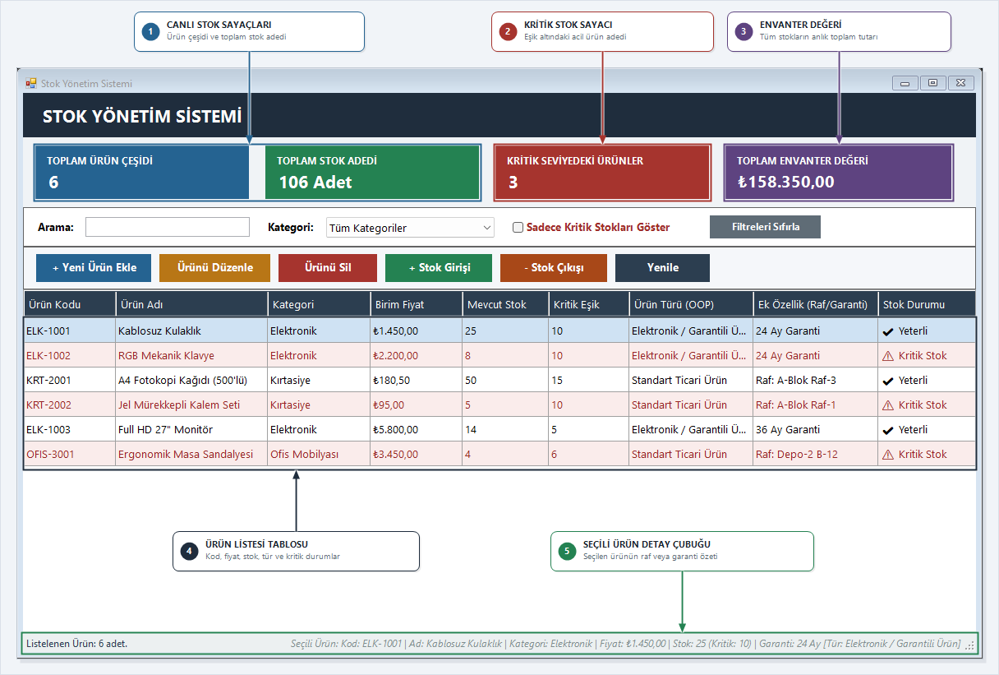
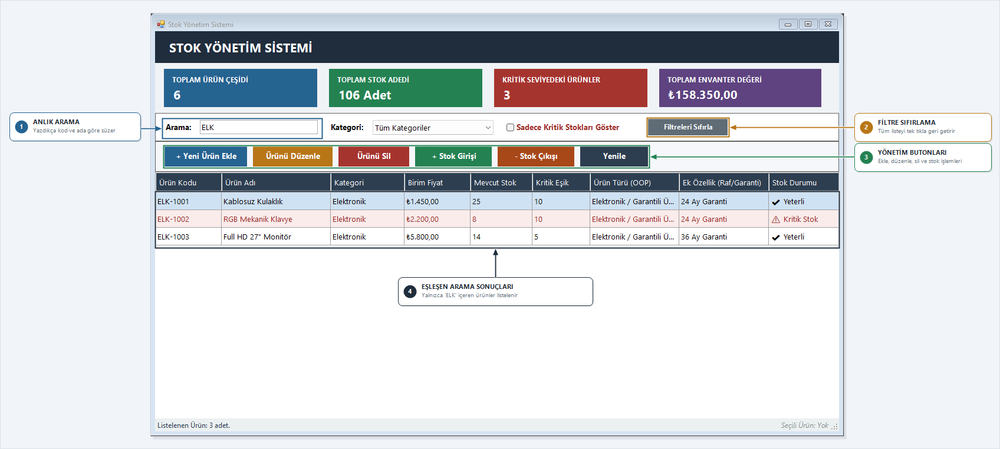
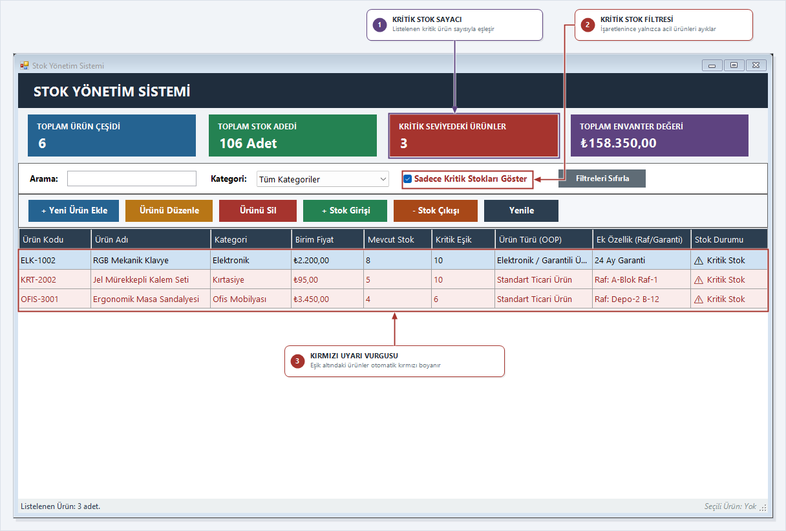
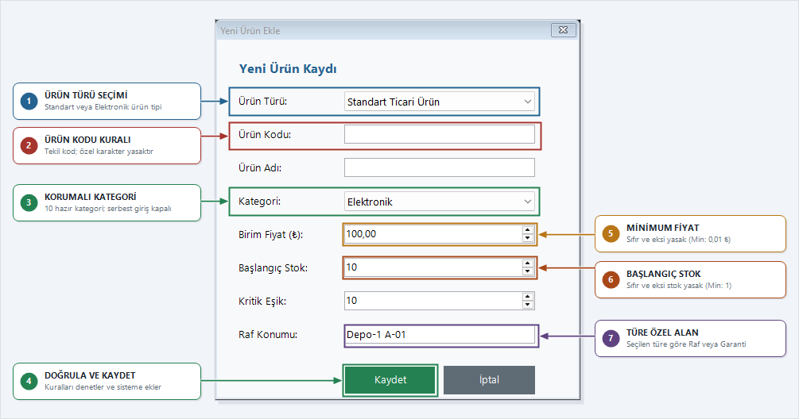
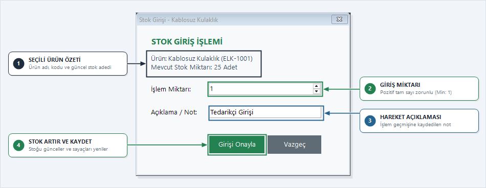
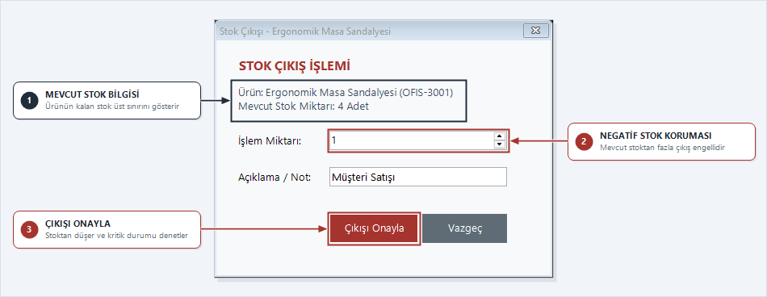
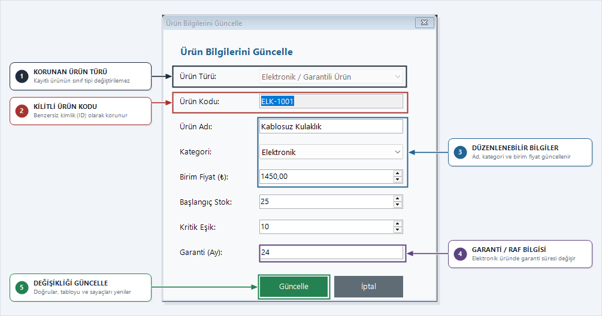
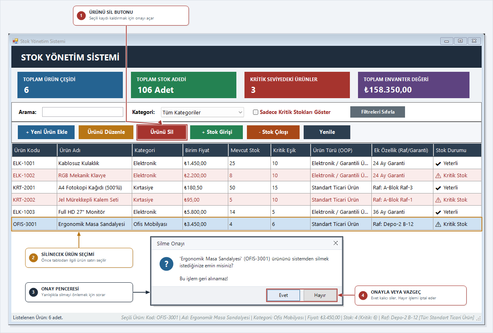

# Stok Yönetim Sistemi (Inventory Management System)

[](https://dotnet.microsoft.com/)
[](https://docs.microsoft.com/en-us/dotnet/csharp/)
[-0078D4)](https://learn.microsoft.com/en-us/dotnet/desktop/winforms/)
[](https://visualstudio.microsoft.com/)
[](#)

> **BST301 • .NET Programlama - I Dersi Proje Ödevi**  
> **Geliştirici:** Fahri Arda Karataş  
> **Öğrenci Numarası:** 25902012  
> **Bölüm:** Bilişim Sistemleri ve Teknolojileri (BST)  
> **Öğretim Elemanı:** Dr. Öğr. Üyesi Tohid YOUSEFİ  
> **GitHub Repository:** Private Repository  
> **Davetli Collaborator:** `tohid.yousefi`

---

## 📑 İçindekiler
1. [Proje Hakkında ve Çözüm Mimarisi](#-1-proje-hakkında-ve-çözüm-mimarisi)
2. [Ekran Görüntüleri ve Kullanım Kılavuzu](#-2-ekran-görüntüleri-ve-kullanım-kılavuzu)
   - [Şekil 1: Ana Ekran Genel Görünümü ve İstatistik Paneli](#şekil-1-ana-ekran-genel-görünümü-ve-canlı-istatistik-paneli)
   - [Şekil 2: Anlık Arama ve Dinamik Filtreleme](#şekil-2-anlık-arama-ve-dinamik-kategori-filtreleme)
   - [Şekil 3: Kritik Stok Takibi ve Renkli Uyarı Sistemi](#şekil-3-kritik-stok-takibi-ve-renkli-uyarı-sistemi)
   - [Şekil 4: Yeni Ürün Ekleme Formu ve Dinamik Alanlar](#şekil-4-yeni-ürün-ekleme-formu-ve-dinamik-alanlar)
   - [Şekil 5: Stok Giriş Formu ve İşlem Onayı](#şekil-5-stok-giriş-formu-ve-kontrollü-miktar-artışı)
   - [Şekil 6: Stok Çıkış Formu ve Negatif Stok Koruması](#şekil-6-stok-çıkış-formu-ve-negatif-stok-koruması)
   - [Şekil 7: Ürün Bilgilerini Güncelleme Formu](#şekil-7-ürün-bilgilerini-güncelleme-formu-düzenleme-modu)
   - [Şekil 8: Güvenli Ürün Silme ve Onay Mekanizması](#şekil-8-güvenli-ürün-silme-ve-onay-iletişim-kutusu)
3. [Nesne Tabanlı Programlama (OOP) Prensipleri](#-3-nesne-tabanlı-programlama-oop-prensipleri)
4. [Savunmacı Programlama (Defensive Programming)](#-4-savunmacı-programlama-defensive-programming-ve-doğrulama)
5. [Test Senaryoları ve Doğrulama Matrisi](#-5-test-senaryoları-ve-doğrulama-matrisi)
6. [Klasör Hiyerarşisi](#-6-klasör-hiyerarşisi)
7. [Kurulum ve Çalıştırma Adımları](#-7-kurulum-ve-çalıştırma-adımları)
8. [Geliştirici Bilgileri](#-8-geliştirici-bilgileri)

---

## 📌 1. Proje Hakkında ve Çözüm Mimarisi

Bu proje, işletmelerin envanter akışlarını, ürün çeşitliliğini, anlık stok miktarlarını ve kritik eşik seviyelerini hatasız yönetebilmeleri amacıyla C# ve .NET Framework Windows Forms mimarisinde geliştirilmiş modern bir **Stok Yönetim Sistemi**dir.

### 🌟 Temel Vurgular ve Tasarım Kararları
- **Veritabanı Bağımsızlığı (In-Memory Yapı):** Şartname 1.2 maddesi gereğince SQL/harici veritabanı kurulmamış; tüm ürün ve işlem verileri RAM belleğinde `List<TemelUrun>` ve `List<StokHareketi>` generic koleksiyonları üzerinde nesne yönelimli olarak işletilmektedir.
- **Katmanlı Ayrım (Separation of Concerns):** Kullanıcı arayüzü (`MainForm`, `UrunDuzenleForm`, `StokIslemForm`), iş kuralları ve veri yönetim servisi (`StokYonetici`), ve veri modeli (`Models`) birbirinden tamamen ayrılmıştır.
- **Çift Kademeli Savunma:** Kullanıcıdan gelen her girdi hem arayüz bileşenleri düzeyinde (`DropDownList`, `NumericUpDown`, `Regex`) hem de domain sınıfları setter düzeyinde denetlenir.

---

## 📸 2. Ekran Görüntüleri ve Kullanım Kılavuzu

Uygulamanın tüm modülleri, kullanıcı dostu arayüzü ve görsel yönlendirmeleri aşağıda adım adım açıklanmıştır:

---

### Şekil 1: Ana Ekran Genel Görünümü ve Canlı İstatistik Paneli

<p align="center">
  
</p>

Ana ekran açıldığında envanterin anlık durumunu özetleyen kontrol paneli ve ürün tablosu kullanıcıyı karşılar:

1. **Üst Başlık ve Kurumsal Bilgi:** Sade ve profesyonel başlık alanı.
2. **Canlı İstatistik Kartları (KPI Dashboard):**
   - **Toplam Ürün:** Sistemde kayıtlı farklı ürün modeli sayısı (`_urunler.Count`).
   - **Toplam Stok:** Depolardaki tüm ürünlerin fiziksel toplam adedi (`_urunler.Sum(u => u.StokMiktari)`).
   - **Kritik Stok:** Eşik değerinin altına düşmüş acil sipariş bekleyen ürün sayısı.
   - **Envanter Değeri:** Depodaki ürünlerin toplam parasal değeri (`Stok * BirimFiyat`).
3. **Arama ve Hızlı Filtre Barı:** Ürün adına göre arama, kategori seçimi ve kritik stok filtresi.
4. **Envanter Veri Tablosu (`DataGridView`):** Ürün kodu, ürün adı, kategori, birim fiyat, mevcut stok, kritik eşik ve dinamik detay bilgisini listeler. Kritik seviyedeki ürünler otomatik olarak pembe/kırmızı tonla vurgulanır.
5. **İşlem Butonları:** Yeni Ürün Ekle, Düzenle, Sil, Stok Girişi, Stok Çıkışı ve Yenile butonları.

---

### Şekil 2: Anlık Arama ve Dinamik Kategori Filtreleme

<p align="center">
  
</p>

Kullanıcı aradığı ürüne binlerce kayıt arasından saniyeler içinde ulaşabilir:

1. **Anlık Metin Arama:** Arama kutusuna yazılan her harfte (`TextChanged` olayı) ürün adı veya ürün koduna göre LINQ filtresi eşzamanlı çalışır.
2. **Kategori Seçimi:** Sabit ve tanımlı kategoriler arasından ComboBox ile seçim yapılır.
3. **Anında Güncellenen Liste:** Arama kriterine uyan kayıtlar anlık olarak tabloda listelenir.
4. **Dinamik Kartlar:** Filtrelenen sonuca göre istatistik sayaçları anlık güncellenir.

---

### Şekil 3: Kritik Stok Takibi ve Renkli Uyarı Sistemi

<p align="center">
  
</p>

Depo tükenmelerini önlemek amacıyla geliştirilen erken uyarı mekanizması:

1. **"Sadece Kritik Stoktakileri Göster" Onay Kutusu:** Tek bir tıkla stok miktarı kritik eşiğin altına inmiş olan ürünler izole edilir.
2. **Görsel Satır Boyama (Row Highlight):** Kritik ürünlerin satır arka planı otomatik kırmızı/pembe tonla boyanarak dikkat çeker.
3. **İkaz Sayacı:** Kritik ürün adedi kartta anlık kırmızı renkle gösterilir.

---

### Şekil 4: Yeni Ürün Ekleme Formu ve Dinamik Alanlar

<p align="center">
  
</p>

Yeni bir ürün sisteme dahil edilirken polimorfik veri girişine olanak tanıyan form:

1. **Ürün Türü Seçimi:** *Standart Ticari Ürün* veya *Elektronik / Garantili Ürün* seçilir.
2. **Polimorfik Dinamik Alan:**
   - Standart ürün seçildiğinde alt alan **Raf Konumu** olarak açılır (Örn: `Depo-1 A-01`).
   - Elektronik ürün seçildiğinde alt alan otomatik olarak **Garanti (Ay)** formatına dönüşür.
3. **Kategori DropDownList:** Kullanıcının elle geçersiz veya hatalı metin girmesi engellenmiştir; yalnızca geçerli iş kategorileri seçilebilir.
4. **Savunmacı Sınırlar:** Fiyat için minimum 0.01 ₺, başlangıç stoğu için minimum 1 adet sınırı uygulanarak sıfır ve eksi girişler fiziksel olarak engellenmiştir.
5. **Ürün Kodu Doğrulaması:** Regex filtresiyle boşluk, Türkçe harf ve özel karakter engellenir; büyük harfe dönüştürülür.

---

### Şekil 5: Stok Giriş Formu ve Kontrollü Miktar Artışı

<p align="center">
  
</p>

Tedarikçiden mal kabulü veya envanter artış işlemlerinde kullanılan güvenli form:

1. **Seçili Ürün Özeti:** Hangi ürün üzerinde işlem yapıldığı ürün kodu ve mevcut stok bilgisiyle birlikte net bir şekilde sunulur.
2. **İşlem Miktarı:** `NumericUpDown` ile minimum 1 adet olacak şekilde pozitif tam sayı girişi zorunlu kılınmıştır.
3. **İşlem Açıklaması:** Yapılan hareketin türü (Tedarikçi Girişi, Sayım Fazlası vb.) belgelenir.
4. **Onay ve Hareket Kaydı:** Onaylandığında ürün stoğu anında güncellenir ve `StokHareketi` günlüğüne işlenir.

---

### Şekil 6: Stok Çıkış Formu ve Negatif Stok Koruması

<p align="center">
  
</p>

Müşteri satışı veya fire çıkışlarında negatife düşmeyi imkansız kılan güvenlik mekanizması:

1. **Mevcut Stok Güvencesi:** Ürünün depodaki mevcut adedi açıkça yazılır.
2. **Fiziksel Maksimum Sınırı:** `numMiktar.Maximum = _urun.StokMiktari` kuralı sayesinde kullanıcı depodaki adetten daha büyük bir rakam seçemez.
3. **Domain Seviyesinde Kontrol:** `TemelUrun.StokCikis()` metodu içindeki kontrol sayesinde yetersiz stok durumunda işlem durdurulur ve `InvalidOperationException` fırlatılır.

---

### Şekil 7: Ürün Bilgilerini Güncelleme Formu (Düzenleme Modu)

<p align="center">
  
</p>

Kayıtlı ürünlerin bilgilerini güncellemek için kullanılan kontrollü arayüz:

1. **Kilitli Ürün Kodu (Primary Key Güvenliği):** Ürün Kodu alanı `ReadOnly` yapılarak veri tabanı anahtarının bozulması engellenir.
2. **Kilitli Ürün Türü:** Nesne kalıtım tipinin (`StandartUrun` / `ElektronikUrun`) çalışma zamanında değiştirilmesi kısıtlanmıştır (`Enabled = false`).
3. **Güncellenebilir Alanlar:** Ürün Adı, Kategori, Birim Fiyat, Kritik Eşik Seviyesi ve türe özgü özellik (Raf Konumu / Garanti Süresi) serbestçe revize edilebilir.

---

### Şekil 8: Güvenli Ürün Silme ve Onay İletişim Kutusu

<p align="center">
  
</p>

Kritik veri kaybını engellemek amacıyla uygulanan teyit adımı:

1. **Seçili Ürünün Vurgulanması:** Silinmek istenen satır `DataGridView` üzerinde açıkça belirlenir.
2. **Modal Onay Penceresi:** Kullanıcıya silinecek ürünün adı ve kodu belirtilerek *"Silmek istediğinize emin misiniz?"* sorusu yöneltilir.
3. **Güvenli Kaldırma:** Yalnızca **Evet** butonuna basıldığında ürün koleksiyondan çıkartılır, silme işlemi hareket kütüğüne kaydedilir ve dashboard anında tazelenir.

---

## 🏛️ 3. Nesne Tabanlı Programlama (OOP) Prensipleri

Proje, 100 puanlık şartname ve değerlendirme rubriğinde istenen tüm OOP kurallarını eksiksiz uygular:

| OOP Prensibi | Projedeki Uygulanışı | İlgili Dosya / Sınıf |
| :--- | :--- | :--- |
| **Kapsülleme (Encapsulation)** | Alanlar `private` tutulmuş, `get`/`set` bloklarında boş değer, negatif fiyat ve negatif stok denetimleri yapılmıştır. | `TemelUrun.cs` |
| **Kalıtım (Inheritance)** | `TemelUrun` soyut sınıfından `StandartUrun` ve `ElektronikUrun` sınıfları türetilmiştir. | `StandartUrun.cs`, `ElektronikUrun.cs` |
| **Çok Biçimlilik (Polymorphism)** | `UrunTuruGetir()` abstract metodu ve `DetayBilgisiGetir()` virtual metodu alt sınıflarca override edilmiştir. | `TemelUrun.cs`, `StandartUrun.cs`, `ElektronikUrun.cs` |
| **Soyutlama (Abstraction)** | Ortak stok sözleşmesi `IStoklanabilir` arayüzü ve `TemelUrun` abstract sınıfı ile kurgulanmıştır. | `IStoklanabilir.cs`, `TemelUrun.cs` |
| **Generic Koleksiyonlar** | Veriler `List<TemelUrun>` ve `List<StokHareketi>` koleksiyonlarında saklanmış; LINQ ile filtrelenmiştir. | `StokYonetici.cs` |

### Kod Örneği: Kapsülleme ve Negatif Stok Koruması (`TemelUrun.cs`)
```csharp
public int StokMiktari
{
    get => _stokMiktari;
    set
    {
        if (value < 0)
            throw new ArgumentOutOfRangeException(nameof(value), "Stok miktarı negatif olamaz!");
        _stokMiktari = value;
    }
}

public virtual void StokCikis(int miktar)
{
    if (miktar <= 0)
        throw new ArgumentException("Çıkış miktarı 0'dan büyük olmalıdır!");

    if (miktar > _stokMiktari)
        throw new InvalidOperationException($"Yetersiz stok! Mevcut stok ({_stokMiktari}), talep edilen ({miktar}).");

    _stokMiktari -= miktar;
}
```

### Kod Örneği: Çok Biçimlilik (Polymorphism)
```csharp
// Temel Sınıf
public abstract string UrunTuruGetir();
public virtual string DetayBilgisiGetir() => $"Kod: {UrunKodu} | Ad: {UrunAdi} | Fiyat: {BirimFiyat:C2}";

// Alt Sınıf 1: StandartUrun
public override string UrunTuruGetir() => "Standart Ticari Ürün";
public override string DetayBilgisiGetir() => base.DetayBilgisiGetir() + $" | Raf: {RafKonumu} [Tür: {UrunTuruGetir()}]";

// Alt Sınıf 2: ElektronikUrun
public override string UrunTuruGetir() => "Elektronik / Garantili Ürün";
public override string DetayBilgisiGetir() => base.DetayBilgisiGetir() + $" | Garanti: {GarantiSuresiAy} Ay [Tür: {UrunTuruGetir()}]";
```

---

## 🛡️ 4. Savunmacı Programlama (Defensive Programming) ve Doğrulama

Kullanıcı hatalarını ve geçersiz durumları engellemek için sistemde uygulanan kurallar:

| Girdi Alanı | Kontrol Mekanizması | Engellenen Hatalı Durum |
| :--- | :--- | :--- |
| **Ürün Kodu** | Regex `^[A-Z0-9\-]+$` ve `UrunKoduVarMi()` | Özel karakterler, Türkçe karakterler, boşluklar ve mükerrer (çift) kod girişi. |
| **Ürün Adı** | `Length >= 2` & `IsNullOrWhiteSpace()` | Boş bırakma veya tek karakterlik anlamsız girişler. |
| **Kategori** | `ComboBoxStyle.DropDownList` | Rastgele geçersiz metin yazılması, tire (-) veya 0 girilmesi. |
| **Birim Fiyat** | `NumericUpDown.Minimum = 0.01` | 0.00 ₺ bedelsiz veya negatif fiyat girilmesi. |
| **Başlangıç Stok** | `NumericUpDown.Minimum = 1` | Stoksuz veya eksi bakiye ile ürün açılışı yapılması. |
| **Stok Çıkışı** | `numMiktar.Maximum = _urun.StokMiktari` | Eldeki stoktan daha fazla çıkış yapılarak bakiyenin eksiye düşürülmesi. |
| **Düzenleme Modu** | `txtUrunKodu.ReadOnly = true` | Birincil kimlik bilgisinin (ID) sonradan bozulması. |

---

## 🧪 5. Test Senaryoları ve Doğrulama Matrisi

Sistem üzerinde icra edilen 7 temel doğrulama senaryosu başarıyla sonuçlanmıştır:

| Test ID | Test Edilen Senaryo | Yapılan İşlem | Beklenen Sonuç | Durum |
| :---: | :--- | :--- | :--- | :---: |
| **T1** | Başarılı Yeni Ürün Ekleme | Standart ve Elektronik ürün formdan eksiksiz dolduruldu. | Ürün listeye eklendi, toplam adet ve çeşit arttı. | ✅ Geçti |
| **T2** | Çift Ürün Kodu Engeli | Mevcut `ELK-1001` kodu ile yeni ürün eklenmek istendi. | Sistem hata uyarısı verdi ve mükerrer kaydı reddetti. | ✅ Geçti |
| **T3** | Yetersiz Stok Çıkış Koruması | 14 adet bulunan monitörden 20 adet çıkış denenmiştir. | Arayüz ve Domain seviyesinde işlem engellendi. | ✅ Geçti |
| **T4** | Anlık Arama ve Filtreleme | Arama kutusuna "Kulaklık" yazılarak filtreleme yapıldı. | Tabloda yalnızca ilgili ürün saniyeler içinde listelendi. | ✅ Geçti |
| **T5** | Kritik Stok Görünümü | "Sadece Kritik Stoktakileri Göster" seçildi. | Yalnızca stoğu eşiğin altındakiler kırmızı satırla listelendi. | ✅ Geçti |
| **T6** | Ürün Bilgisi Güncelleme | Birim fiyat ve raf konumu değiştirilip kaydedildi. | Ürün kodu ve türü korunarak bilgiler güncellendi. | ✅ Geçti |
| **T7** | Güvenli Ürün Silme | Sil butonuna basılıp onay kutusu onaylandı. | Ürün sistemden silindi, istatistik kartları güncellendi. | ✅ Geçti |

---

## 📂 6. Klasör Hiyerarşisi

```text
Stok_Yonetimi_GitHub_Repo/
│
├── screenshots/                                 # GitHub README'de kullanılan yüksek çözünürlüklü ekran görüntüleri
│   ├── 01_AnaEkran_Genel.png                    # Ana ekran ve dashboard görünümü
│   ├── 02_Arama_Filtreleme.png                  # Anlık arama ve dinamik filtreleme
│   ├── 03_Kritik_Stok_Gorunumu.png              # Kritik stok ve kırmızı satır vurgulaması
│   ├── 04_Urun_Ekleme_Ekrani.png                # Yeni ürün kayıt formu ve doğrulamalar
│   ├── 05_Stok_Giris_Ekrani.png                 # Stok artırma formu
│   ├── 06_Stok_Cikis_Ekrani.png                 # Stok çıkış formu ve bakiye koruması
│   ├── 07_Urun_Duzenle_Ekrani.png               # Bilgi güncelleme formu
│   └── 08_Urun_Silme_Onayi.png                  # Silme teyit iletişim kutusu
│
└── README.md                                    # Kapsamlı GitHub repository ana dokümantasyonu
```

---

## 💻 7. Kurulum ve Çalıştırma Adımları

### Seçenek 1: Doğrudan Çalıştırılabilir Uygulama (Hızlı)
1. `02_Application/InventoryManagementSystem.exe` dosyasına çift tıklayınız.
2. Uygulama herhangi bir harici kurulum veya SQL sunucusu gerektirmeden, örnek test verileriyle birlikte doğrudan açılacaktır.

### Seçenek 2: Visual Studio ile Derleme
1. `01_SourceCode/InventoryManagementSystem.sln` çözüm dosyasını **Visual Studio 2022** ile açınız.
2. Üst menüden derleme profilini `Release` veya `Debug` olarak seçiniz.
3. Klavyeden **`F5`** tuşuna basarak veya yeşil **`Start (Başlat)`** butonuna tıklayarak projeyi çalıştırabilirsiniz.

### Sistem Gereksinimleri
- **İşletim Sistemi:** Windows 10 / Windows 11
- **Çalışma Zamanı:** Microsoft .NET Framework 4.8 veya üzeri
- **Geliştirme Ortamı:** Visual Studio 2019 / 2022 (WinForms iş yükü ile)

---

## 👤 8. Geliştirici Bilgileri

- **Adı Soyadı:** Fahri Arda Karataş  
- **Öğrenci No:** 25902012  
- **Bölüm:** Bilişim Sistemleri ve Teknolojileri (BST)  
- **Ders:** BST301 - .NET Programlama - I  
- **Ders Sorumlusu:** Dr. Öğr. Üyesi Tohid YOUSEFİ  
- **GitHub Collaborator:** `tohid.yousefi`  
- **Teslim Dönemi:** 2026-2027 Güz Yarıyılı  
